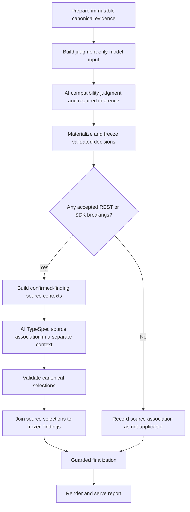

# Post-Judgment TypeSpec Source Association

**Status: Implemented; four fresh PR assessments finalized, served, and measured.**

This user-directed follow-up separates compatibility judgment from completing
the TypeSpec source shown on breaking-change cards. It replaces the proposed
single-phase source-review timing in [refactor-design.md](refactor-design.md)
for new pipeline-version-2 runs. Existing assessment boundaries, API-version selection,
compatibility rules, and report layout remain unchanged.

## 1. Decision

Use two independently bounded AI stages:

1. **Judge candidates.** Complete Semantic summaries, REST/downstream decisions,
   requested inference, and Azure Guidelines assessment. Validate and freeze
   the compatibility decisions.
2. **Associate source for confirmed breakings.** Only after judgment succeeds,
   ask AI to review a deterministic proposal and select the most relevant,
   complete canonical TypeSpec code for accepted REST/downstream findings.

Rejected candidates, no-impact inference results, informational publication
intents, and blocked changes without a confirmed finding do not receive a
source-association task. Documentation remains deterministic. Guidelines use
their existing intent-scoped source evidence, not this breaking-only stage.

The distinction is **evidence for deciding compatibility** versus **source
completion for presenting a confirmed finding**. Stage 1 is not source-blind:
it keeps the changed-source evidence required by Semantic judgment and complete
evidence for declared unknown changes. It does not build a large declaration
selection inventory or ask AI to complete display snippets for every candidate.

## 2. Why change the boundary

The verified #44988 comparison illustrates the current coupling:

| Input                                                       | Compact JSON bytes |
| ----------------------------------------------------------- | -----------------: |
| Historical file-grouped input                               |            199,300 |
| Later input with joint judgment/source review               |          1,597,205 |
| Current diagnostic input after consumer-propagation removal |          1,564,975 |

The current input has 12 source-review requests, 1,459 shared declaration
metadata entries, and 8,835 available-declaration ID references. Six REST
requests each repeat the same 1,459 available and deterministic IDs.
`sourceReviewRequests` and `sourceReviewDeclarations` alone occupy 923,723
bytes, approximately 59% of the input, before any candidate is accepted.

Source review therefore consumes judgment context even for candidates that
will be rejected. Its effort and time are also inseparable from compatibility
reasoning. The two-stage boundary removes this premature work.

It does not by itself fix project-wide source fallback or inference fact
retention. The second stage must use finding-specific source contexts; moving
the same 1,459-declaration payload into a second prompt is not this design.

## 3. Proposed pipeline



Retain the existing coordinator, judgment materializer, finalizer, and server.
The agent workflow admits one additional bounded source stage; it does not
require a user-selected mode, manual extra command, generic workflow engine,
or an AI call for each card.

Final `assessment.json` and `assessment.html` are published only after both
stages have a validated disposition. Do not finalize a public assessment after
Stage 1 and then patch its findings or HTML in place.

## 4. Stage 1: judge and freeze

### Input and duties

Keep in `model-input.json`:

- compact candidate deltas and the contract evidence needed to judge them;
- source/API comparison identities and provenance-bound canonical references;
- deterministic Semantic groups and their bounded changed-source synopses;
- declared unknown-hunk inference requests with the complete required evidence;
- shared official-guidance search requests.

Do not include `sourceReviewDeclarations`, `sourceReviewRequests`, or
candidate display-completion proposals. Do not request `sourceReviews` in the
new judgment decision schema.

AI judges every required deterministic and inferred candidate, including
reject decisions. A lack of display source is neither a reason to approve nor
a reason to reject a candidate. Missing compatibility evidence still requires
an explicit blocker; it cannot be deferred to a source-only stage.

### Materialization

`materialize-assessment-results.ts` validates the new judgment schema, exact
candidate/inference coverage, identities, evidence, and shared guidance, then
atomically writes its existing inference, guidance, and judgment artifacts.
It no longer requires source-review decisions for this new pipeline version.

The successful result freezes:

- approved finding/candidate IDs, dimensions, contract identities, and deltas;
- severities, compatibility rationales, and rejected decisions;
- canonical evidence and comparison hashes;
- Semantic group membership and proven finding-to-intent relationships;
- compatibility verdicts and coverage derived from these decisions.

The source-stage builder reuses the deterministic candidate-to-finding join
and card grouping used by assembly. It must not add a second set of grouping
heuristics. Its confirmed-finding manifest lives in the source-stage input;
there is no intermediate final `assessment.json`.

Persist a judgment snapshot hash. Any changed decision or canonical input
invalidates downstream source inputs and results. Reusing historical decisions
is not a fresh judgment measurement.

## 5. Stage 2: associate code only for confirmed findings

### Task granularity

Create one association item per existing, proven breaking card/contract unit,
covering its accepted finding IDs. Several deltas for the same operation or
model can share one source selection. If the owning contract is unresolved,
retain a separate finding-level item rather than grouping by a guessed name.

Every accepted REST/downstream finding belongs to exactly one item within its
dimension. Include accepted inferred findings and non-model client/customization
findings. Never lose an accepted finding because it does not fit a model card.

Sharing a canonical code bundle across REST and SDK items is allowed when the
source identity and comparison match. Their findings, verdicts, and item
coverage remain independent; source reuse does not establish cross-dimension
causality.

### Input contents

`source-association-input.json` contains:

- the frozen judgment hash, canonical source hash, and comparison identity;
- confirmed item IDs and exact member finding IDs;
- the concrete breaking deltas and relevant contract facts, without all
  Stage 1 candidate, inference, or guidance inventories;
- a narrow deterministic source proposal with its mapping evidence;
- a shared registry of the canonical declarations/snippets actually needed;
- provenance-bound references for targeted expansion when initial mapping
  cannot establish sufficient source.

A proposed compact shape is:

```json
{
  "schemaVersion": 1,
  "judgmentHash": "sha256:<frozen-judgment>",
  "sourceIndexHash": "sha256:<canonical-source>",
  "items": [
    {
      "id": "source-association-<stable-id>",
      "dimension": "rest",
      "findingIds": ["rest-<accepted-id>"],
      "contractIdentity": "<verified-identity>",
      "evidenceFactIds": ["<relevant-fact-id>"],
      "sourceContextId": "source-context-<stable-id>",
      "proposal": {
        "status": "associated",
        "declarationIds": ["<canonical-declaration-id>"],
        "basis": "<verified-mapping>"
      }
    }
  ],
  "facts": {},
  "sourceContexts": {},
  "declarations": {}
}
```

The actual schema must define types, roles, bounded expansion references, and
provenance before implementation. This example is not an existing API.
Store each shared declaration/snippet once. Requests reference a context ID
instead of repeating identical available and deterministic ID arrays.

### Deterministic proposal and AI selection

For direct operation changes, start from verified operation/compiler mapping.
Provide the complete affected operation/template invocation, relevant
decorators, and necessary direct support. An entire interface or source file
is not automatically relevant.

For model/property changes, follow the proven contract identity/path to its
owning model. Provide the complete owning model, including model/member
decorators and unchanged members required by the approved unified-diff layout.
Several unrelated models in one hunk remain separate.

Property ownership and value-type identity are distinct. A removed, newly
required, retyped, or nullable-restricted member belongs to its declaring model,
not the named model/enum used as its value. Traversal retains both identities;
rule-aware card grouping and source proposals select the owner, while value
rendering retains the referenced type. Definition-level enum changes still
belong to the enum. A deterministic proposal is reviewable evidence, not an
instruction to reject a canonical owner that contradicts an incorrect label.

AI checks relevance and completeness, keeping a good proposal, refining a
poor one, or associating source when deterministic mapping is missing. It
returns canonical declaration IDs and a concise selection rationale, never
authored TypeSpec, invented locations, or replacement code.

AI can retrieve a complete declaration and necessary supporting helpers from
indexed, immutable source artifacts. Empty `hunkIds` is not permission to load
every changed file or declaration. Shared filenames, operation-name substring
similarity, and membership in the same intent do not prove a mapping.

When a proposal is missing, use a targeted query derived from the finding's
verified identity, contract location, project, and comparison roles. Resolve
queries deterministically against the scoped canonical index and record the
retrieved identities/hashes. Return ambiguity or missing evidence explicitly.
Do not send a global 1,459-ID selection list merely to enable fallback AI
search, or recursively scan the repository.

The initial context and expansion remain within the selected assessment
scope. Required unchanged support can be indexed from its immutable source
snapshot. Dependency/common-type code is included only when a specific
selection needs it and its provenance is available; never load the entire
common-types library.

### Separate AI context

Stage 2 receives its own bounded model input and instructions. Do not simulate
separation by adding a new tool call after judgment while retaining the entire
Stage 1 conversation and every rejected candidate in its AI context.

Batch all confirmed items in one source-only invocation when they fit. If
necessary, partition by confirmed items and shared contexts without duplicating
judgment or running an invocation per finding by default. This is a bounded
stage, not a large multi-agent workflow.

The source-only AI cannot change judgment decisions, severity, compatibility
rules, evidence facts, API versions, or Semantic/finding group membership.

## 6. Source decisions and validation

Finding-to-intent links remain deterministic. REST model findings use
project-scoped canonical owner/member declarations and primary changed-hunk
ownership, rather than only the report's operation inventory. Member ownership
takes precedence over a whole model spanning several changes. Ambiguous
ownership, supporting display code, or same-file coincidence does not establish
a link. Assembly also generates reciprocal intent impact links. For #46679,
CloudAccountProperties and ActivateSaaSParameterRequest findings link to their
canonical contract-change intent without revising AI judgment.

Write a separate `source-association-decisions.json`, not a revised
`agent-workspace\agent-decisions.json`. Its entry contains `itemId`, `outcome`,
`selectedDeclarationIds`, and `rationale`, plus the bound judgment/source hashes.

| Outcome      | Meaning                                                                      |
| ------------ | ---------------------------------------------------------------------------- |
| `keep`       | The deterministic proposal is already the complete minimal relevant code     |
| `refine`     | Keep the supported ownership, improve completeness, or remove unrelated code |
| `associate`  | No adequate deterministic proposal; AI selects verified canonical source     |
| `unresolved` | Reviewed evidence does not establish a reliable selection                    |

Rejected candidates have no task and no `not-applicable` decision here.
No confirmed breakings produces a deterministic stage-level `not-applicable`
disposition and no AI invocation.

A small deterministic source materializer validates exact item coverage,
nonempty rationales, unique selections, outcome semantics, comparison roles,
canonical ID/hash ownership, and registered expansion results. It resolves
selections to complete canonical source locations and writes a validated
`source-association.json` atomically.

The finalizer joins these selections to findings, leaving authoritative
compatibility content unchanged. Reuse the existing `displaySources` and
`sourceReview` output concepts where practical; expand item decisions to their
covered finding IDs deterministically. Do not serialize another full canonical
source copy per delta solely because an item covers multiple findings.

The renderer consumes these validated selections. Model cards keep one
complete owning-model unified diff; direct operation/method cards keep complete
relevant constructs. No affected-operation/type-to-method inventories return.

## 7. Missing evidence, contradictions, and recovery

Source coverage is independent from compatibility coverage:

- Missing a source side is visible; never substitute an unrelated revision.
- An evidence-backed `unresolved` source decision preserves its breaking
  finding and reason. It does not turn a failure into a pass or claim complete
  source coverage.
- AI/tool failure is not an authored `unresolved` decision. Record a source
  stage failure explicitly. A partial report may be finalized only with a
  validated, explicit `not-assessed` source disposition for every omitted item
  and visible limitations; never silently reuse the broad source inventory.
- A proven contradiction with the frozen contract identity is escalated as
  `requires-judgment-review`. Stage 2 does not edit or silently override Stage 1.
  Explicitly revising judgment invalidates prior source results; there is no
  automatic reasoning loop or completed report with contradictory evidence.
- Hash mismatch, fabricated selection, or invalid coverage is a hard validation
  error, not partial source coverage.

Corrections target the failing phase's artifact. Source-selection correction
must not rerun preparation or candidate judgment. A judgment/schema correction
before freezing remains in Stage 1. Preserve the bounded correction policy,
with phase-aware errors instead of routing every failure back to
`awaiting-agent-judgment`.

## 8. Workflow state and timing

Add explicit states around the existing finalizer:

```text
awaiting-agent-judgment
  -> judgment-materialized
  -> awaiting-source-association       (only when confirmed breakings exist)
  -> source-association-materialized   (or explicit not-applicable/not-assessed)
  -> finalizing
  -> complete                         (then render-serving completion)
```

Record hashes and completion disposition for both stages. Stage retries
accumulate timing without allowing a partial artifact to look complete.

Measure separately:

- judgment input bytes/tokens and candidate/inference counts;
- judgment AI time and judgment materialization/correction time;
- confirmed finding count and deduplicated source item/context counts;
- deterministic proposal/source-input construction time;
- source input bytes/tokens and actual source-expansion reads/bytes;
- source AI time and source materialization/correction time;
- finalization, successful-attempt, and cumulative end-to-end time.

Use measured phase boundaries rather than attributing filesystem timestamps
or the whole Agent wait interval to reasoning. Missing timing remains unknown.
Token estimates must be labeled; do not confuse them with provider usage.

For #44988, excluding the two current source-review sections from Stage 1
accounts for 923,723 bytes of section contents. That is diagnostic arithmetic,
not a measured implementation result or a guaranteed total-cost reduction.
Broad evidence sets and inference facts still require separate narrowing.

Two AI contexts add invocation overhead and may duplicate small finding
summaries. Total runtime or tokens can increase if most candidates are accepted
or source retrieval is expensive. Report actual costs for both stages; do not
claim an automatic speedup or push an oversized input into Stage 2.

## 9. Implementation surfaces and compatibility

| Surface                                                     | Required change when approved                                                                 |
| ----------------------------------------------------------- | --------------------------------------------------------------------------------------------- |
| `run-assessment-analysis.ts` / `build-agent-workspace.ts`   | Build judgment-only input; do not build display source-review inventories before judgment     |
| Judgment schema / `materialize-assessment-results.ts`       | Validate judgment without source decisions in the new pipeline; freeze validated output       |
| Source input builder and source materializer                | Reuse canonical lookup/grouping and add only the two-stage boundary responsibilities          |
| `runtime-types.ts` and new source-stage schemas             | Describe item coverage, contexts, outcomes, provenance, and independent source status         |
| `assemble-assessment.ts` / `finalize-assessment.ts`         | Join the separate source artifact after judgment, enforce hashes and phase-aware recovery     |
| `assessment-report-ui.ts` / renderer / validation           | Reuse complete-model diff layout; make unavailable/not-assessed source explicit               |
| `workflow-state.ts`                                         | Record both stages, their hashes, timings, and dispositions                                   |
| `SKILL.md` / workflow references / current `docs/design.md` | Replace the single-input/single-decision instructions only when implementing the new pipeline |

Select the path with an explicit pipeline-format discriminator. Existing
single-phase artifacts with source reviews remain readable and reproducible;
do not infer a new two-stage run from a coincidentally absent file.
Legacy report replay does not invoke new AI association automatically.

Keep existing compatibility analysis and historical reading at the boundary.
Do not restore consumer-propagation graphs, rewrite mixed-intent grouping,
raise the global input budget, or generate SDKs as part of this change.

## 10. Acceptance

1. Stage 1 carries no source-completion requests/registry and judges every
   required deterministic and inferred candidate.
2. Stage 2 covers exactly the frozen accepted REST/downstream findings; rejected
   and no-impact results never trigger source work.
3. Source grouping is deterministic and does not merge compatibility dimensions
   or reconstruct consumer relationships.
4. #44988 direct Service Gateway findings do not default to all Network
   declarations. Shared contexts/snippets and ID sets are encoded once.
5. #46679 model cards still show the complete owning-model unified diff,
   including unchanged members and relevant decorators.
6. #44288 operation/template changes retain complete generic arguments and
   necessary support; source association does not manufacture missing contract
   coverage.
7. A run with zero accepted breakings, including #43918 when supported by its
   fresh judgment, skips Stage 2 without fabricating source work.
8. Hash changes, extra/missing items, invented IDs, invalid outcomes, missing
   revisions, unresolved source, tool failure, and contradictions follow the
   distinct validation/recovery paths above.
9. Historical single-phase inputs/reports remain readable. No phase is marked
   complete simply because an empty or stale source artifact exists.
10. Fresh sequential runs of all four PRs produce served reports and separate
    judgment/source/total performance measurements, without a speculative
    performance threshold or silent reduction of evidence coverage.

## 11. Mandatory four-PR measurements

The results below were captured before stacking on the preview-only baseline
policy PR. They remain historical measurements of this refactor, not golden
compatibility verdicts for the combined stack. Parent-layer target-only
eligibility and runtime-integrity rules take precedence in new runs.

Run #46679, #44988, #44288, and #43918 sequentially after implementation,
using fresh output directories and fresh, separate judgment/source AI contexts.
Do not reuse prior Agent decisions as new benchmark results. Record the actual
PR target/head, API selections, artifact hashes, failures, retries, and any
explicit input-budget override alongside the results.

Populate the following table from successful runs. Values remain pending until
measured; skipped source AI is `0` input bytes and `0` seconds, with an explicit
not-applicable disposition. Missing or failed measurements are not zero.

| PR     | Judgment input (bytes) | Judgment AI wall time (s) | Source input (bytes) | Source AI wall time (s) | Preparation (s) | Materialization + finalization (s) | End-to-end (s) |
| ------ | ---------------------: | ------------------------: | -------------------: | ----------------------: | --------------: | ---------------------------------: | -------------: |
| #46679 |                169,837 |                   454.966 |               64,471 |                 175.819 |         108.101 |                              0.409 |      3,710.900 |
| #44988 |                626,953 |                   612.884 |               39,974 |                  86.792 |         661.230 |                              1.528 |      2,118.669 |
| #44288 |                 42,769 |                   235.764 |               31,005 |                 139.387 |          96.266 |                              0.408 |        795.981 |
| #43918 |                 54,656 |                   423.961 |                    0 |                   0.000 |         111.031 |                              0.282 |        698.648 |

Measure compact UTF-8 JSON consistently for both model inputs. If source items
require multiple batches, record each batch and the aggregate input size; record
additional retrieved source bytes separately. AI wall time includes that phase's
input loading, tool activity, and model work; it is not an isolated provider
reasoning duration. Materialization/finalization does not include AI time.

Timings were captured at successful guarded finalization. A final
presentation-only refresh expanded complete operation snippets and removed
contained duplicate snippets without changing frozen judgments, source
selections, or model inputs. Its report hashes and refresh time are recorded
separately from the captured measurement milestone.

Retain source-input construction, correction, cumulative failed-attempt time,
and actual/estimated token usage in the accompanying structured timing artifact.
Give each row its served report URL and absolute `assessment.json` path.
Inspect complete-model diffs and the absence of consumer inventories before
considering the row complete. Compare historical and new input sizes
descriptively, without inferring a latency improvement from byte reduction.

### Measured run notes

**2026-11-09 correction:** The original #46679 EntityInfo source limitation
described below was caused by confusing a removed property's value type with
its declaring model, not by missing CloudAccountProperties source. The repaired
rule-aware traversal keeps both identities. Source association was rerun against
the unchanged frozen judgment and all 14 findings now have resolved source;
the two REST property removals show complete baseline/current
CloudAccountProperties declarations. The report at the same URL is refreshed.
The November 6 performance table remains historical and is not relabeled as
timing for this source-only repair.

- #46679: [served report](http://127.0.0.1:59992/assessment.html), structured result
  `C:\Users\haolingdong\.copilot\session-state\c837dd38-0f77-40c1-945f-67b440b1bd7b\files\two-stage-assessment\pr-46679-run1\assessment.json`.
  Fresh judgment produced 4 REST and 10 SDK findings with partial compatibility
  coverage. Final source association covered all 14 findings in 7 items, with 10 unique
  selected declarations and explicit unresolved EntityInfo source for 2 REST
  findings. Source coverage is partial, independently of compatibility findings.
  The RoleAssignment complete-model unified diff and the
  absence of consumer inventories were inspected in the served browser.
  Judgment wall time includes one interruption while consuming an oversized
  tool-output buffer; the same canonical read was continued. A source CLI flag
  retry and a rejected-candidate source-review guard defect were corrected before
  finalization without rewriting frozen decisions or source selections. End-to-end
  time includes these engineering/retry gaps, the intervening #44988 attempt,
  and a source-only rerun after fixing lossy-summary contract ownership. It is
  wall-clock completion time, not a steady-state latency or isolated compute
  estimate. The prior source attempt took 132.425 seconds; the table shows the
  corrected source attempt and the structured artifact retains both. Final
  selection does not substitute a consuming request model for unavailable
  EntityInfo code.

- #44988 run1 reached judgment and source materialization but failed guarded
  finalization on 10 shared physical hunks duplicated across Network and Vmss.
  Its measured failed-attempt wall time was 1,833.034 seconds. The global ownership
  key was repaired while preserving each project's operation/API-version
  evidence. A fresh run2 is selected for the final table; run1 decisions are not
  reused as fresh judgments.

  Run2 finalized and is [served here](http://127.0.0.1:60361/assessment.html):
  `C:\Users\haolingdong\.copilot\session-state\c837dd38-0f77-40c1-945f-67b440b1bd7b\files\two-stage-assessment\pr-44988-run2\assessment.json`.
  It preserves 6 REST and 3 SDK findings. Source association covers all 9 in 5
  items, with 10 unique declarations and no unresolved source. Complete Service
  Gateway operation/template arguments were inspected in the served report.
  One concurrent query failure was retried serially; the workflow now requires
  serial query registration. End-to-end wall time includes source-rendering
  verification and engineering gaps; the prior failed attempt is recorded
  separately, not hidden in the successful row.

- #44288: [served report](http://127.0.0.1:62098/assessment.html), structured result
  `C:\Users\haolingdong\.copilot\session-state\c837dd38-0f77-40c1-945f-67b440b1bd7b\files\two-stage-assessment\pr-44288-run1\assessment.json`.
  It retains 4 REST and 4 SDK findings with partial compatibility coverage.
  Source association covers all 8 in 4 items, using 6 unique declarations.
  The complete parent/connection template arguments were inspected. Some
  supporting template/resource definitions remain outside indexed scope; the
  source rationales disclose this without changing compatibility judgments.

- #43918: [served report](http://127.0.0.1:51809/assessment.html), structured result
  `C:\Users\haolingdong\.copilot\session-state\c837dd38-0f77-40c1-945f-67b440b1bd7b\files\two-stage-assessment\pr-43918-run1\assessment.json`.
  Fresh judgment produced no confirmed REST or SDK breakings and 12 no-impact
  inference results. Source association was deterministically not applicable:
  no source AI invocation, with zero model input bytes sent to that stage.
  Compatibility verdict remains unknown/blocked because existing evidence
  limitations persist; zero findings are not represented as a proof of safety.

Machine-readable measurements, attempts, source-expansion bytes, canonical
hashes, and report links are saved in
`C:\Users\haolingdong\.copilot\session-state\c837dd38-0f77-40c1-945f-67b440b1bd7b\files\two-stage-assessment\four-pr-results.json`.
The accompanying `collect-results.mjs` reproduces the table from the selected
runs and their captured timing milestones.

For #44988, judgment input is 626,953 bytes versus the later joint-phase
1,597,205-byte input. The separate confirmed-source input is 39,974 bytes.
These are initial bounded inputs, not total billed tokens: source queries,
guidance retrieval, prompts, output, and retries have additional costs. The
results demonstrate separation and narrower source context, not an automatic
latency improvement.
