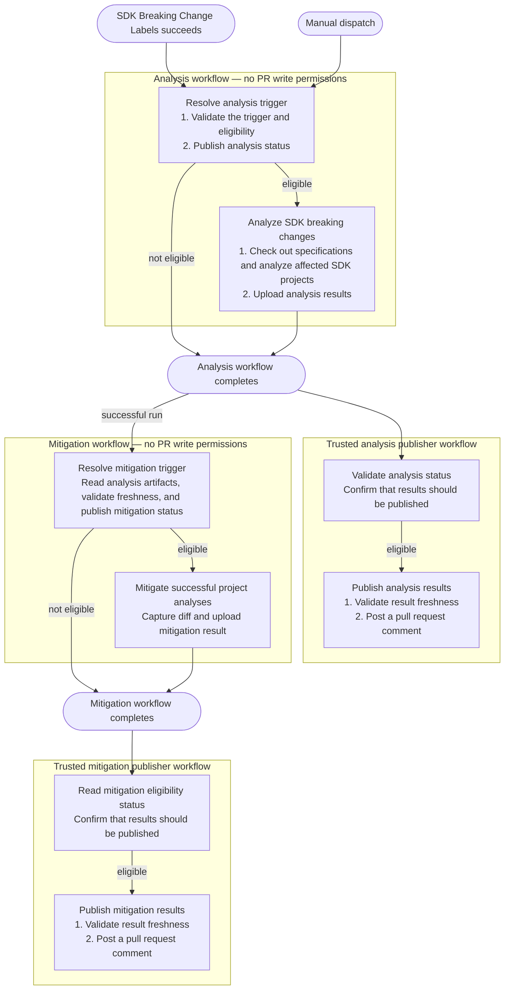

# SDK Breaking Change Detection, Analysis, and Mitigation Workflow

## Overview

SDK breaking changes must be detected and addressed before a specification pull request can
merge. This process identifies breaking changes early and prevents them from propagating to
downstream SDK repositories, reducing back-and-forth across repositories and stages.

To support this process, we will implement GitHub Actions workflows that automatically detect SDK
breaking changes in specification pull requests and propose mitigations for contributors to review
and apply.

### Architecture

There are four workflows:

- `SDK Breaking Change Analysis - Analyze`
- `SDK Breaking Change Analysis - Publish Results`
- `SDK Breaking Change Mitigation`
- `SDK Breaking Change Mitigation - Publish Results`

**Flow**:



## Developer implementation contract

This section documents the workflow permissions and responsibilities, trust boundaries, artifact
ownership and schema compatibility, and freshness and status invariants. It also describes the
analysis and mitigation workflows, including their triggers, execution, concurrency controls,
result schemas, and PR comment behavior.

### Workflow permissions and contracts

| Workflow                                                                         | Permissions                                                                                                                    | Contract                                                                                                                                                       |
| -------------------------------------------------------------------------------- | ------------------------------------------------------------------------------------------------------------------------------ | -------------------------------------------------------------------------------------------------------------------------------------------------------------- |
| [Analysis - Analyze](../../sdk-breaking-change-analysis.yaml)                    | Resolver: `actions: read`, `contents: read`, `pull-requests: read`. Analysis job: `contents: read`, `copilot-requests: write`. | Resolve one PR/language, analyze affected projects, and publish eligibility and analysis artifacts without PR writes.                                          |
| [Analysis - Publish Results](../../sdk-breaking-change-analysis-status.yaml)     | Eligibility job: `actions: read`. Publisher job: `actions: read`, `contents: read`, `issues: write`, `pull-requests: write`.   | Read the triggering run's artifacts, validate the result, check successful-result freshness, and publish the analysis comment.                                 |
| [Mitigation](../../sdk-breaking-change-mitigate.yaml)                            | Resolver: `actions: read`, `contents: read`. Mitigation job: `contents: read`, `copilot-requests: write`.                      | Consume analysis artifacts, validate mitigation eligibility and freshness, capture the specification diff, and publish mitigation artifacts without PR writes. |
| [Mitigation - Publish Results](../../sdk-breaking-change-mitigation-status.yaml) | Eligibility job: `actions: read`. Publisher job: `actions: read`, `contents: read`, `issues: write`, `pull-requests: write`.   | Read the mitigation run's eligibility and result artifacts, validate the result, check successful-result freshness, and publish the mitigation comment.        |

### Trust boundaries and workflow-chain constraints

- Keep workflow orchestration and publishing modules in the trusted workflow checkout. Check out
  specification PR content separately under `repositories/azure-rest-api-specs`; do not import
  publisher code from that checkout.
- Generation and mitigation consume PR specifications and run language tooling. Their execution
  jobs have `contents: read` and `copilot-requests: write`, but no issue or PR write permissions.
  A read-only repository token does not make the input specifications trusted.
- Only the publisher jobs receive `issues: write` and `pull-requests: write`. They consume JSON and
  status data, not executable code from result artifacts. Never execute or apply the downloaded
  `customizationCode` diff in a publisher.
- Download artifacts using `github.event.workflow_run.id`, not a latest-run lookup or artifacts
  with the same name from another run. Schema validity alone does not establish artifact provenance.
- Preserve the exact upstream workflow names in `workflow_run.workflows`. Publishers handle
  `success` and `failure` conclusions, then require eligibility `true`; canceled or skipped runs
  do not enter the publishing jobs.

### Artifact ownership and compatibility

[types.ts](./types.ts) owns the versioned `AnalysisResultSchema` and `MitigationResultSchema`;
both currently require `schemaVersion: 1`. Producers and consumers must agree on filenames,
field names, language identities, and status meanings. An incompatible change requires coordinated
schema-version and consumer updates; changing an artifact's display name alone does not version it.

| Artifact                                     | Producer                                         | Consumer                                   | File and invariant                                                                                                                                                                                       |
| -------------------------------------------- | ------------------------------------------------ | ------------------------------------------ | -------------------------------------------------------------------------------------------------------------------------------------------------------------------------------------------------------- |
| `sdk-breaking-change-analysis-status`        | Analysis workflow: `resolve` job                 | Analysis publisher and mitigation resolver | `run`: unversioned plain-text `true` or `false` plus newline. The publisher trims and validates the value; mitigation proceeds only for `true`. This is analysis eligibility, not completion or success. |
| `sdk-breaking-change-results`                | Analysis workflow: `analyze` job                 | Analysis publisher and mitigation workflow | `sdk-breaking-change-analysis.json`: `AnalysisResultSchema`, version 1.                                                                                                                                  |
| `sdk-breaking-change-mitigate`               | Mitigation workflow: `resolve-trigger` job       | Mitigation publisher                       | `run`: unversioned plain-text `true` or `false` plus newline. Indicates mitigation eligibility, not whether every change was resolved.                                                                   |
| `sdk-breaking-change-mitigation-results`     | Mitigation workflow: `mitigate` job              | Mitigation publisher                       | `sdk-breaking-change-mitigation.json`: `MitigationResultSchema`, version 1.                                                                                                                              |
| `issue-number=<number>` and `head-sha=<sha>` | Both publishing workflows: `publish-results` job | Downstream PR status workflows             | Values are encoded in artifact names, not JSON; preserve those prefixes.                                                                                                                                 |

### Freshness and status invariants

1. Keep `prNumber`, `headSha`, and `sdkLanguage` associated throughout analysis, mitigation,
   artifacts, outputs, and comments. Use the analyzed specification SHA, not the workflow
   checkout's default-branch SHA.
2. Both analysis trigger paths reject fork PRs. Automatic label-triggered runs additionally
   compare the label artifact's SHA with the live PR head before analysis.
3. The mitigation resolver requires that analysis was requested, that the overall analysis succeeded,
   and that the current PR head matches the analyzed SHA before setting mitigation eligibility to `true`. Mitigation
   preserves the input analysis SHA in its output and processes only projects with
   `analysisStatus: "success"`. Empty breaking-change lists do not invoke customization.
4. Both publishers compare successful results with the current PR head immediately before
   producing their reports. A mismatch produces a stale-result warning instead of an outdated
   change table.
   Failure results are reported without that freshness check.
5. Overall `status: "success"` means execution completed, not that no breaking changes remain.
   Read per-project `analysisStatus` for analysis and per-change `isResolved` for mitigation.
   Individual project failures can coexist with an overall successful analysis.
6. The eligibility artifact is written by the resolver even when analysis will not run. A `true`
   eligibility file does not guarantee that a result file was produced: setup or analysis can fail
   first. Keep missing-artifact failures distinct from valid failure-result JSON.

### `SDK Breaking Change Analysis - Analyze`

The [analysis workflow](../../sdk-breaking-change-analysis.yaml) detects and analyzes SDK breaking
changes and produces an artifact and a GitHub Actions job summary.

#### Triggers and execution

- `workflow_dispatch`: accepts `pr_number` and `sdk_language`. Language inputs use repository-map
  keys such as `Go`, `Python`, `Java`, `Js`, and `Net`.
- `workflow_run`: runs after `SDK Breaking Change Labels` completes successfully. The resolver
  reads its PR number, head SHA, and language-specific breaking-change label artifacts. Analysis
  runs only when the supported label artifact has the value `true`.
- Both paths reject fork PRs. For an automatic run, the current PR head must also match the SHA
  recorded by the label workflow.

The resolver exposes the PR number, head repository and SHA, SDK language and repository, and
`should-run` as job outputs. When eligible, the analysis job:

1. Checks out the SDK repository's `main` branch and the specification PR's resolved head SHA.
2. Installs the Azure SDK CLI, Copilot CLI, and language-specific development tools.
3. Identifies affected TypeSpec projects from the files changed in the PR.
4. Reads each project's language metadata and output directory, then runs SDK generation, build,
   and breaking-change detection. Python skips the build step.
5. Writes the result JSON and a job summary containing generation, build, and detection details.
6. Uploads the result artifact whenever the file is available, even if the analysis step fails.

#### Concurrency control

The `analyze` job uses the concurrency group `sdk-breaking-analysis-<pr-number>-<sdk-language>`
with `cancel-in-progress: true`. A new analysis job cancels any in-progress analysis job for the
same PR and SDK language, whether triggered manually or by the labels workflow. Jobs for different
PRs or SDK languages use separate groups and can run concurrently. This control applies to the
analysis job, not the resolver or downstream publishing and mitigation workflows.

#### Output artifacts and schema

Both artifacts have a seven-day retention period:

| Artifact                              | File                                | Purpose                                                                                                                        |
| ------------------------------------- | ----------------------------------- | ------------------------------------------------------------------------------------------------------------------------------ |
| `sdk-breaking-change-analysis-status` | `run`                               | Plain-text `true` or `false`, followed by a newline. Indicates whether analysis was eligible to run, not whether it succeeded. |
| `sdk-breaking-change-results`         | `sdk-breaking-change-analysis.json` | Versioned analysis result consumed by the publisher and mitigation workflow.                                                   |

The result contract is defined by [AnalysisResultSchema](./types.ts). The publisher validates the
downloaded JSON against this schema before using it.

```typescript
type AnalysisResult = {
  schemaVersion: 1;
  prNumber: number;
  headSha: string;
  sdkLanguage: string;
  analysisWorkflowUrl: string;
  status: "success" | "failure";
  errorMessage?: string;
  projects: {
    typespecProject: string;
    sdkPackage: string;
    analysisStatus: "success" | "failure" | "skipped";
    breakingChanges: {
      breakingChange: string;
      category: string;
      suggestedFix: string;
    }[];
  }[];
};
```

Example of a successful result containing a detected breaking change:

```json
{
  "schemaVersion": 1,
  "prNumber": 42,
  "headSha": "00850ca596599f280dc140fa4cc14dc613e9192b",
  "sdkLanguage": "Go",
  "analysisWorkflowUrl": "https://github.com/Azure/azure-rest-api-specs/actions/runs/123",
  "status": "success",
  "projects": [
    {
      "typespecProject": "specification/service/Widget.Service",
      "sdkPackage": "armwidget",
      "analysisStatus": "success",
      "breakingChanges": [
        {
          "breakingChange": "Model property removed",
          "category": "spec change",
          "suggestedFix": "Restore the removed property."
        }
      ]
    }
  ]
}
```

#### Publish result in PR comment

The publisher runs after a successful or failed analysis workflow.

For a successful result, the publisher compares the PR's current head SHA with `headSha` before
posting the report. The comment starts with a language-specific command, followed by the analyzed
commit and one table per project:

```markdown
/azsdk sdk-breaking-analysis Go

## SDK Breaking changes for Go

**Analyzed commit:** `00850ca596599f280dc140fa4cc14dc613e9192b`

**Typespec Project:** specification/service/Widget.Service

**SDK Package:** armwidget

| #   | Breaking change        | Category    | Suggested fix                 |
| --- | ---------------------- | ----------- | ----------------------------- |
| 1   | Model property removed | spec change | Restore the removed property. |

[SDK breaking change analysis details](https://github.com/Azure/azure-rest-api-specs/actions/runs/123#breaking-changes)

<!-- sdk-breaking-change-head-sha: 00850ca596599f280dc140fa4cc14dc613e9192b -->
<!-- /azsdk sdk-breaking-analysis Go -->
```

Comment behavior:

- **Current successful result:** posts the report shown above. Row numbering starts at one for
  each project. Empty change arrays use a `No SDK breaking changes detected.` placeholder row. The
  comment renderer does not display `analysisStatus`, so this placeholder alone does not establish
  that a failed or skipped project was successfully analyzed; check the artifact or job summary.
- **Failed result:** posts an error message prefixed with a cross mark, the optional `errorMessage`,
  and a workflow-run link instead of the project tables. This path does not perform a freshness check.
- **Stale successful result:** posts a warning containing both the analyzed SHA and the current PR head
  SHA instead of publishing the old report.
- **Repeat publication:** updates the last matching comment authored by `github-actions[bot]`
  for the same language command. An identical body is left unchanged. Contributor-authored comments
  are not updated.

The publisher also exposes `issue_number` and `head_sha` outputs and uploads matching artifacts
for downstream PR status processing.

### `SDK Breaking Change Mitigation` workflow

The [SDK Breaking Change Mitigation workflow](../../sdk-breaking-change-mitigate.yaml) consumes
results from `SDK Breaking Change Analysis - Analyze` and proposes mitigations for the detected
SDK breaking changes.

#### Triggers and execution

- `workflow_run`: listens for completion of `SDK Breaking Change Analysis - Analyze`. The
  `resolve-trigger` job runs only when that analysis workflow concludes successfully.
- [resolveMitigationTrigger](./resolve-mitigation-inputs.ts) downloads the eligibility and result
  artifacts from the triggering analysis run. Mitigation proceeds only if the analysis `run` flag
  is `true`, the overall analysis status is `"success"`, and the current PR head SHA matches the
  analyzed `headSha`.
- If analysis was not requested, the analysis result indicates failure, or the SHA is stale, the
  resolver records mitigation eligibility as `false`. Missing artifacts and invalid results cause
  resolution to fail.

The resolver exposes the following step outputs, which are forwarded as `resolve-trigger` job outputs:

- `pr-number`: specification PR number from the validated analysis result.
- `sdk-language`: SDK language from the analysis result.
- `sdk-repository`: SDK repository name mapped from `sdk-language`.
- `head-repository`: full specification PR head repository name (`owner/repository`).
- `head-branch`: specification PR head branch name.
- `head-sha`: current PR head SHA, verified to match the analyzed commit.
- `should-run`: string `"true"` when mitigation is eligible; otherwise `"false"`.

#### Concurrency control

The mitigation concurrency group is `sdk-breaking-mitigate-<analysis-workflow-run-id>`, with
`cancel-in-progress: true`. It is scoped to the triggering analysis run, not to a PR/language pair.

#### Output artifacts and schema

The mitigation workflow consumes `sdk-breaking-change-analysis-status` and
`sdk-breaking-change-results` from the triggering analysis run. It publishes two artifacts, each
retained for seven days:

| Artifact                                 | File                                  | Purpose                                                                                                                               |
| ---------------------------------------- | ------------------------------------- | ------------------------------------------------------------------------------------------------------------------------------------- |
| `sdk-breaking-change-mitigate`           | `run`                                 | Separate mitigation eligibility flag: plain-text `true` or `false` plus newline. Its publisher validates this flag before publishing. |
| `sdk-breaking-change-mitigation-results` | `sdk-breaking-change-mitigation.json` | Mitigation results and the captured specification diff consumed by the mitigation publisher.                                          |

The analysis schema is described above. The mitigation module validates its output against
[MitigationResultSchema](./types.ts), and the publisher validates the downloaded result again.
The mitigation result contract is:

```typescript
type MitigationResult = {
  schemaVersion: 1;
  prNumber: number;
  headSha: string;
  sdkLanguage: string;
  mitigationWorkflowUrl: string;
  status: "success" | "failure";
  customizationCode: string;
  projects: {
    typespecProject: string;
    sdkPackage: string;
    breakingChanges: {
      breakingChange: string;
      suggestedFix: string;
      isResolved: boolean;
      typespecChangesSummary?: string[];
    }[];
  }[];
  errorMessage?: string;
};
```

For example, execution can succeed even if the CLI cannot resolve a change and produces no edits:

```json
{
  "schemaVersion": 1,
  "prNumber": 42,
  "headSha": "00850ca596599f280dc140fa4cc14dc613e9192b",
  "sdkLanguage": "Go",
  "mitigationWorkflowUrl": "https://github.com/Azure/azure-rest-api-specs/actions/runs/456",
  "status": "success",
  "customizationCode": "",
  "projects": [
    {
      "typespecProject": "specification/service/Widget.Service",
      "sdkPackage": "armwidget",
      "breakingChanges": [
        {
          "breakingChange": "Model property removed",
          "suggestedFix": "Restore the removed property.",
          "isResolved": false
        }
      ]
    }
  ]
}
```

An error caught by the outer mitigation handler, such as an invalid customization target, produces
`status: "failure"`, an `errorMessage`, and an empty `projects` array. Input-file or schema errors
occur before that handler and can prevent the mitigation result from being written. The upload
step runs with `if: always()` but fails if the mitigation file is missing.

#### Publish result in PR comment

The mitigation publisher handles successful and failed `SDK Breaking Change Mitigation` runs,
requires the `sdk-breaking-change-mitigate` eligibility artifact to contain `true`, and downloads
the mitigation result artifact from that exact run.
For successful results, it compares the current PR head SHA with `headSha` before rendering the report.

The example above produces the following comment:

```markdown
/azsdk sdk-breaking-mitigate Go

## SDK breaking-change mitigation for Go

**Mitigation upon commit:** `00850ca596599f280dc140fa4cc14dc613e9192b`

**TypeSpec project:** specification/service/Widget.Service

**SDK package:** armwidget

**Resolved Breaking Changes:**

None

**Unresolved Breaking Changes:**

| Breaking change        | Suggested resolution          |
| ---------------------- | ----------------------------- |
| Model property removed | Restore the removed property. |

**Customization Code:**

No mitigation changes were produced.
[View customization code in the workflow summary](https://github.com/Azure/azure-rest-api-specs/actions/runs/456)

<!-- sdk-breaking-change-head-sha: 00850ca596599f280dc140fa4cc14dc613e9192b -->
<!-- /azsdk sdk-breaking-mitigate Go -->
```

Comment behavior:

- **Current successful result:** groups changes into resolved and unresolved tables for each project.
  The resolved table uses `Breaking change`, `Resolution`, and `TypeSpec changes` columns; only the
  first `typespecChangesSummary` entry is shown. Empty groups display `None`.
  Nonempty resolved tables appear in a details block that is expanded by default.
  The report also includes **Customization Code** as a fenced diff in a collapsed-by-default
  details block when edits exist, or the
  no-changes message above otherwise. The comment includes the full trimmed diff without
  truncation and also links to the job summary.
- **Failed result:** posts an error message prefixed with a cross mark, optional failure details,
  and the mitigation workflow link instead of the change tables. This path does not check freshness.
- **Stale successful result:** posts a warning containing the analyzed SHA and current PR head SHA
  instead of the mitigation report.
- **Repeat publication:** updates the last matching `github-actions[bot]` comment for the same
  language-specific mitigation command. Contributor comments remain unchanged; identical content
  requires no update.

The command and hidden markers follow the shared comment protocol. The publisher also emits
`issue_number` and `head_sha` outputs and matching artifacts for downstream PR status processing.
