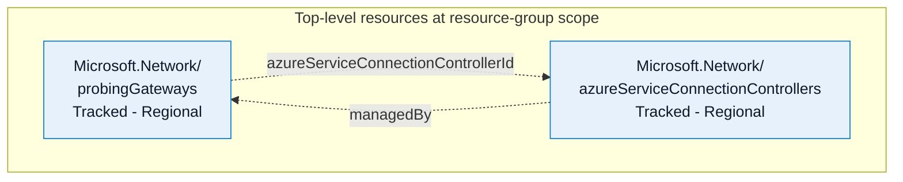

# Probing Gateway and Azure Service Connection Controller: Modeling Review Agenda

## Review status

- Prepared: 2026-10-19.
- Status: pending human modeling review; not an approval or completed RP-contract import.
- Recommended action: ARM Modeling Office Hours.
- Primary contact: Azure Traffic Manager / aztmcore (as supplied).
- Submitter: pending.
- Scope: Microsoft.Network/probingGateways and Microsoft.Network/azureServiceConnectionControllers, API version 2026-02-09-preview.
- Registration intent: augment/update the existing controller resource-type registration only; not a full Microsoft.Network registration.
- No review has been booked or submitted by this assessment.

## Customer outcome

A Probing Gateway uses its Azure Service Connection Controller to manage private outbound connectivity through provider connections and private endpoints.

## Source-derived baseline

Both resources are top-level, resource-group-scoped tracked resources. Their operations include GET, lists by resource group and subscription, and asynchronous PUT/DELETE. Gateway PATCH is asynchronous; controller PATCH synchronously updates tags only.

The gateway has a read-only controller resource ID. The controller has a top-level, creation-only `managedBy` reference. The source documentation denies direct customer PUT/DELETE on the controller and states that gateway deletion also deletes the controller and its managed resources. This documents intent, not a verified authorization implementation.

The relationship is a reference between top-level resources, not an ARM parent/child path.

## Confirmed property remediation

| Change | Feedback evidence | Authority / confidence | Confirmed edit |
|---|---|---|---|
| Return provider-connection IP configuration | The model accepted a non-secret value on write but excluded Read visibility | Local API review and partner-confirmed persisted semantics / high | Include the persisted configuration on reads and in response examples; preserve write support |
| Establish effective-route ownership | The model described an effective route but exposed it as writable | Local API review and partner-confirmed service ownership / high | Make `udr` read-only and describe it as service-selected |

These changes do not resolve or approve the lifecycle design below.

## Open questions for modeling reviewers

### 1. Gateway-only authorization and controller ownership

- Evidence: controller documentation denies direct customer PUT/DELETE while the API exposes both operations; `managedBy` identifies the managing resource.
- Missing decision: which authenticated principal performs these operations, how gateway ownership is validated, and whether customers can create or reassign an orphan controller.
- Recommendation: document the exact principal, permissions, ownership checks and error behavior. Do not treat `managedBy` as an authorization mechanism.
- Authority / confidence: local TypeSpec establishes intent with high confidence; enforcement and reviewer acceptance are unverified.
- Reviewer decision / owner: pending.

### 2. Cascading cleanup and partial failures

- Evidence: gateway/controller documentation ties controller lifecycle to gateway deletion and promises cleanup of managed resources.
- Missing decision: cleanup ordering, retry/idempotency behavior, failed deletion recovery, and when the gateway DELETE completes.
- Recommendation: define the cascade completion boundary and recovery path explicitly, including private endpoints and any service-created infrastructure. Identify which referenced resources are customer-owned and must not be deleted.
- Authority / confidence: cascade intent is source-derived; cleanup implementation and resource ownership remain unverified.
- Reviewer decision / owner: pending.

### 3. Resource-group and subscription deletion

- Evidence: the managed controller is a separate top-level tracked resource, potentially referencing infrastructure in another resource group.
- Missing decision: deletion ordering and behavior when the gateway's group, controller's group or private-endpoint group is deleted, including repeated DELETE after cleanup.
- Recommendation: agree on bulk-deletion handling, already-deleted responses, and recovery without depending on the customer invoking a denied controller operation.
- Authority / confidence: source-derived resource shape / high; platform integration is pending verification.
- Reviewer decision / owner: pending.

### 4. Disablement, cancellation and subscription lifecycle

- Partner intent: delete resources on disablement, cancellation and subscription deletion.
- Missing decision: map those business events to actual subscription states, timing and reactivation/recovery expectations; Registered and Warned behavior remains unspecified.
- Recommendation: review destructive disablement/cancellation cleanup separately from permanent subscription deletion. Standard suspension behavior commonly retains resources while blocking writes; do not claim the proposed deviation is approved.
- Authority / confidence: partner intent is confirmed; policy compatibility and precise state mapping are unresolved.
- Reviewer decision / owner: pending.

### 5. Resource moves and same-subscription constraints

- Evidence: the gateway subnet is immutable, controller ownership is creation-only, and the private-endpoint resource group must remain in the controller's subscription.
- Missing decision: whether gateway/controller moves are supported together, reference updates, dependent-resource moves and constraints across resource groups/subscriptions.
- Recommendation: confirm the tracked-resource move contract and test reference consistency. Do not silently change immutable fields or declare move support from the schema alone.
- Authority / confidence: schema constraints / high; runtime move support is unverified.
- Reviewer decision / owner: pending.

### 6. Dependencies, identities and permissions

- Evidence: the API references subnets, private endpoints, resource groups and routes, and exposes managed-on-behalf-of configuration.
- Partner answer: downstream dependencies pending.
- Missing decision: actual downstream calls, identities, required permissions, ownership boundaries and dependent-team agreements.
- Recommendation: produce a call/permission matrix. Distinguish resource references from confirmed deployment prerequisites, and do not invent application IDs or role assignments.
- Authority / confidence: referenced resource types / high; dependencies and authorization are unconfirmed.
- Reviewer decision / owner: pending.

## Evidence and source register

| Claim | Evidence | Authority | Confidence / use |
|---|---|---|---|
| Gateway resource shape, operations and controller reference | [Gateway models](../specification/probinggateway/resource-manager/Microsoft.Network/ProbingGateway/models/ProbingGatewayModels.tsp), [gateway operations](../specification/probinggateway/resource-manager/Microsoft.Network/ProbingGateway/interfaces/ProbingGateway.tsp) | Local specification | High / baseline, not proof of runtime behavior |
| Controller ownership, denied customer operations and tags-only PATCH | [Controller operations](../specification/azureserviceconnectioncontroller/resource-manager/Microsoft.Network/AzureServiceConnectionController/interfaces/AzureServiceConnectionController.tsp) | Local specification | High / documented intent |
| Configuration visibility, route ownership and resource references | [Controller models](../specification/azureserviceconnectioncontroller/resource-manager/Microsoft.Network/AzureServiceConnectionController/models/AzureServiceConnectionControllerModels.tsp) | Local specification plus partner confirmation | High / property remediation |
| Customer outcome, contact, lifecycle intent, registration update, pending dependencies | Partner answers in the modeling interview and remediation confirmation | Partner | Confirmed intent / not reviewer approval |
| Readable persisted configuration and explicit field ownership | [OAPI027 and OAPI034](../.github/skills/azure-api-review/references/property-mutability.md) | Repository ARM review guidance | Applied to property remediation |
| Managed-resource platform semantics | [managedBy guidance](../.github/instructions/arm-api-review.instructions.md#22-managedby-property) | Repository ARM review guidance | Review basis; authorization still requires confirmation |
| Tracked lifecycle and moves | [Tracked-resource lifecycle guidance](../.github/skills/azure-api-review/references/tracked-resource-lifecycle.md) | Repository ARM review guidance | Review basis; runtime compliance not established |
| Subscription suspension recommendation | Subscription lifecycle default in the modeling workflow; [ARM RPC](https://eng.ms/docs/products/arm/api_contracts/resource-provider-contract/v10) | Bundled guidance; live RPC not verified here | Recommendation only |

## Review handoff

1. Nominate a submitter and reviewers.
2. [Book ARM Modeling Office Hours](https://bookings.cloud.microsoft/book/ARMOfficeHours1@microsoft.onmicrosoft.com/?ismsaljsauthenabled=true) and share this agenda with both service owners.
3. Record decisions and evidence for each open question, including exceptions and follow-up owners.
4. Apply confirmed API decisions through the TypeSpec validation workflow. Resolve registration prerequisites separately.

This document is a review agenda only. It is not a lossless `rp-contract.yaml`, a registration baseline, or an authorization to deploy.