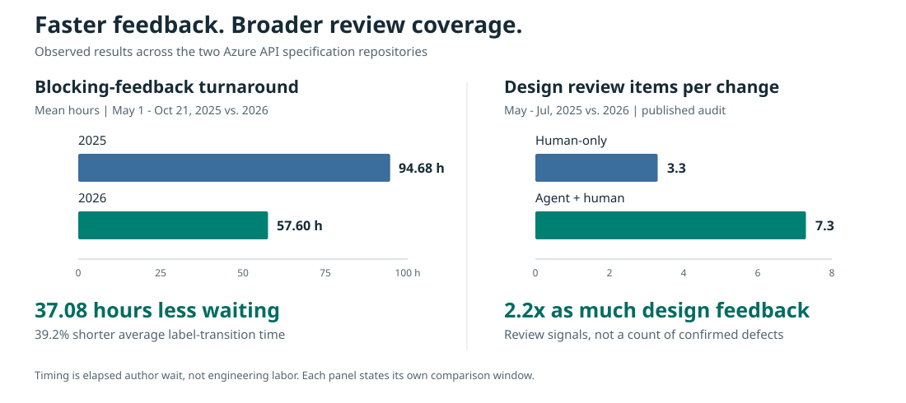
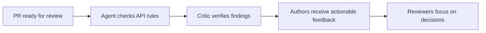

# ARM API Reviewer: Impact at Scale

**Leadership and engineering briefing | October 22, 2026**

The ARM API Reviewer adds a consistent review pass across Azure API changes.
It gives authors more design feedback and helps reviewers identify risks before
an API ships. The strongest measured gains are:

- **39.2% shorter average wait for blocking feedback**, year over year.
- **2.2 times as many design review items per change** with agent-assisted review.
- **2,024 distinct findings surfaced**, including **472 blocking findings**.

These figures use different, explicitly stated windows. The turnaround result is
an observed service improvement, not a measure of engineering labor saved or
proof that AI alone caused it.

## Faster Feedback for Authors

Compare **May 1 through October 21** in 2025 and 2026 across both specification
repositories. October is limited to the same completed days in each year.

| Measure                                 |    2025 |    2026 |                          Improvement |
| --------------------------------------- | ------: | ------: | -----------------------------------: |
| PRs in the blocking-feedback comparison |     223 |     198 |      One observation per PR per year |
| Average label-transition time           | 94.68 h | 57.60 h | **37.08 h shorter; 39.2% reduction** |
| Median label-transition time            | 58.17 h | 20.06 h |                  **65.5% reduction** |
| Blocking feedback within 24 hours       |   32.3% |   56.1% |    **23.8 percentage points higher** |

The clock runs from `WaitForARMFeedback` to `ARMChangesRequested`. The average
reduction has a **95% bootstrap confidence interval of 8.74 to 60.09 hours**.
Equal-count and request-date checks also show shorter waits in this year-over-year
comparison. This measures completed blocking reviews, not time to sign-off or merge.

## More Capacity Under Higher Demand

| Measure, May 1-October 21                               |  2025 |  2026 |
| ------------------------------------------------------- | ----: | ----: |
| New PRs across the two repositories                     | 6,182 | 6,909 |
| Eligible ARM feedback requests, including repeat cycles |   847 | 1,020 |
| People who applied blocking-review labels               |    20 |     9 |

Overall PR volume rose **11.8%**, and ARM feedback requests rose **20.4%**.
Fewer people applied blocking-review labels. That is a participation measure,
not a count of staffed reviewers or full-time equivalents.

The agent adds repeatable checking capacity without requiring a person to
perform every first-pass check. In the published May-July comparison, authors
received **7.3 design review items per agent-assisted change**, versus **3.3**
with human-only review. The agent contributed 5.2 of the 7.3 items; people
continued reviewing alongside it.

Automated review execution took a **median of 14 minutes**, with **91% finishing
within 30 minutes**, in the published August workflow sample. This is execution
time, not the end-to-end label-transition time above.

## Broader Coverage of API Risk

The published April-August audit recorded **2,024 distinct findings across
412 PRs**, reaching **288 developers** and **119 resource providers**.

- **665 findings addressed contract risk**, including resource models,
  compatibility, HTTP behavior, and long-running operations. **222 were blocking**.
- **68 findings concerned security and secrets; 32 were blocking.** For example,
  the agent [flagged secret-capable fields on new response paths](https://github.com/Azure/azure-rest-api-specs/pull/42319#discussion_r3759767783).
- Findings also covered missing schema constraints, incompatible property changes,
  invalid resource models, and incomplete long-running-operation headers.

This systematic second pass is valuable when demand grows and review attention
is constrained. It surfaces additional signals that a time-limited review may
overlook. The data does not establish how many findings a human would have missed,
or how many became confirmed defects.

## Leadership Takeaway

**Continue expanding the agent as a review-capacity and API-risk capability.**
The evidence supports broader feedback coverage and a meaningful year-over-year
improvement in completed blocking-feedback turnaround. Keep human accountability
for review decisions, and measure finding acceptance, remediation, and reviewer
effort next to quantify quality and labor benefits directly.

## Evidence and Scope

- Turnaround and demand: fresh GitHub label-history analysis for matched
  May-October days in 2025 and 2026.
- Feedback depth: the published May-July 2025/2026 comparison.
- Finding counts and reach: the published April 22-August 24, 2026 audit.
- Execution speed: 126 workflow runs from August 7-24, 2026.

The finding audit has not been extended to October. A separate adjacent-period
comparison did not establish a turnaround improvement, so the year-over-year
gain should not be described as an isolated AI effect. Definitions, category
counts, checks, and source links are in the
[methodology appendix](arm-api-reviewer-impact-methodology.md).
