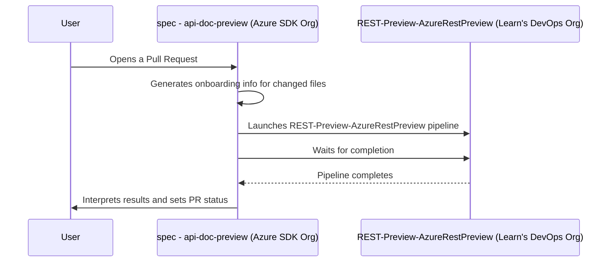

## How do I onboard my API to publish docs?

Follow instructions at [Publish REST API reference docs
](https://eng.ms/docs/products/azure-developer-experience/design/api-docs)

## How do I troubleshoot docs build problems?

Follow instructions at [Troubleshooting REST API documentation
](https://eng.ms/docs/products/azure-developer-experience/design/api-docs-troubleshooting)

## How does it work?

When a user opens a PR to a specs repo, the [`spec - api-doc-preview`](https://dev.azure.com/azure-sdk/internal/_build?definitionId=7767&_a=summary) pipeline launches, selects and onboards swaggers into the [preview repo](https://github.com/MicrosoftDocs/AzureRestPreview), then launches a pipeline in the Learn org to generate an API preview. The `spec - api-doc-preview` pipeline waits for the Learn org's pipeline to complete, then reports the status back to the PR in the form of a commit status.

